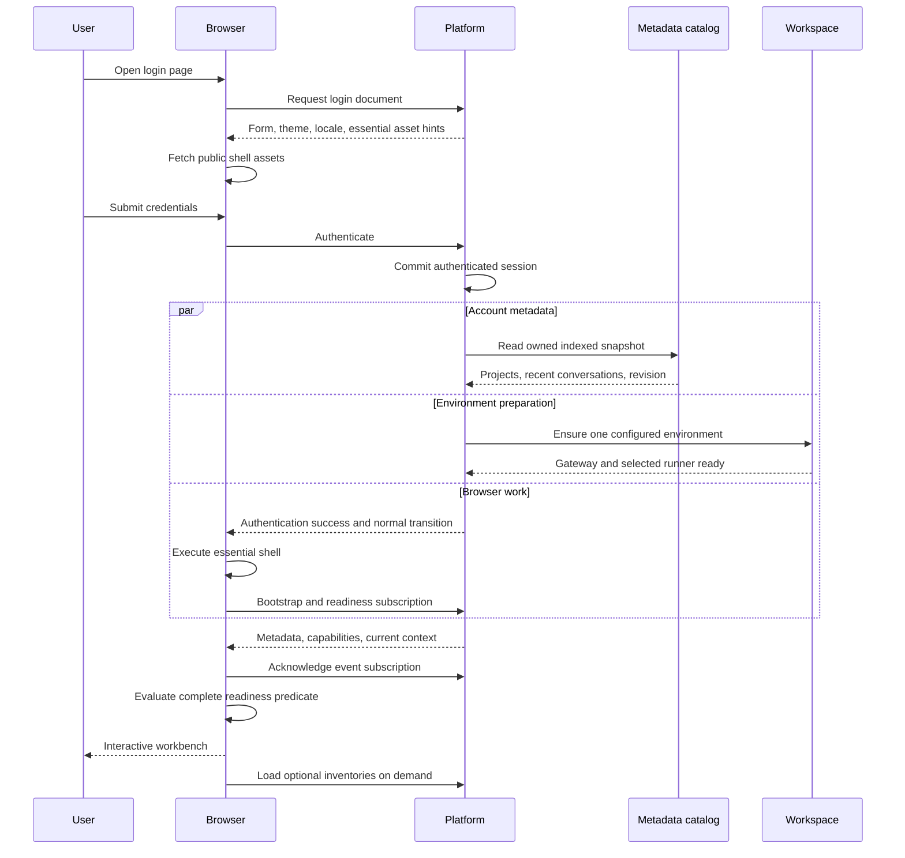

# Web Login and Workspace Readiness

Date: 2026-10-21
Status: Design complete; implementation and live performance acceptance pending.
Scope: The public multi-user Web client and its managed workspace services.

## 1. User requirements

- Submitting valid credentials should lead to a usable workbench within three seconds when execution capacity is available, including an idle cold workspace.
- Loading should make useful progress during the existing login transition. The user should encounter one continuous transition, with their language and appearance preserved.
- The first usable screen must contain the correct account, selected assistant and default model, projects, and a trustworthy first page of conversations. Sending a message and opening project files must work.
- Recent and older conversations must remain discoverable across projects and supported assistant histories. Pagination must preserve access to every conversation.
- Logging into another account must not routinely discard an idle account's prepared environment. Running work, uncertain work, and user data remain protected.
- Capacity contention must produce a clear waiting state within three seconds, with account actions available. Authentication failures, service failures, and capacity waiting require distinct handling.
- The design must fit the current 3.3 GiB host. Resource protection, account isolation, request generation checks, and recoverable data are release requirements.

This document specifies one integrated design. The implementation plan is
[Web Login Performance](../plans/2026-10-21-web-login-performance.md).

## 2. Verified observations and their limits

The following observations came from the deployed service and its frozen source,
rather than the older, modified main checkout.

| Observation | Evidence | Consequence |
| --- | --- | --- |
| The selected assistant is Codex with `gpt-6.1-sol`. | Authenticated `/api/runtime`: `runtime=codex`, `managed=true`, `enabled=true`, `status=ready`, policy revision 38. | OpenCode protocol names do not describe the active assistant. Readiness must follow the selected runtime. |
| Authentication itself was fast in the measured warm case. | Login 93 ms; identity 135 ms; projects 162 ms. | Reducing password verification alone cannot remove the observed delay. |
| Eight sequential directory session reads took 15,702 ms. | Individual reads took 1,771–2,245 ms; total measured login sequence 16,355 ms. | Directory count currently multiplies discovery work. |
| Cold workspace identity took 21,791 ms in a separate observation. | Authenticated `/v1/whoami`; the following session list took 4,854 ms. | Cold preparation needs independent optimization. These measurements do not attribute all startup time to one component. |
| Frontend session discovery is sequential by directory. | `OpenCodeClient.listSessions()` loops over directory queries. `runtime.ts` obtains project roots before listing. | Parallelizing the same directory requests would preserve unnecessary backend work. |
| Each directory query repeats account-wide discovery. | `ConversationRouter.#snapshot()` reads canonical state, CLI history, and OpenCode sources; `list()` applies its directory filter afterward. Platform OpenCode discovery enumerates roots again. | Introduce one indexed account-wide listing with server-side filtering and pagination. |
| List failure can restart an otherwise healthy connection. | `connectOnce()` couples list completion to a 15-second deadline and reconnect/recovery. | Keep environment connection and metadata loading independent. |
| Login already preloads some assets and overlaps some startup. | `login-page.mjs` emits preload links; successful HTML login schedules worker preparation without awaiting it. | Extend the existing overlap and make HTML/JSON behavior consistent. |
| Managed startup starts the gateway twice. | `startTenant()` calls `gateway.start()`; profile configuration calls `gateway.start(profile)`; `TenantGateway.start()` stops its previous child. | Configure once and make equal-profile initialization idempotent. |
| Gateway startup and status currently require OpenCode. | `osd-cli/server.rs` starts the runtime before its HTTP gateway; control-plane startup waits on OpenCode `/session`; workspace status probes `/session/status`. | Codex readiness must use its actual gateway/runner capabilities. |
| Account preparation currently displaces another idle worker. | `ManagedWorkerManager.#start()` stops other running idle workers; scheduler defaults to one sandbox and one job. | Separate resident environments from executing jobs under one aggregate resource limit. |

Measurements are stored in ignored diagnostic artifacts under
`.deploy/diagnostics/`: `workspace-connection-20261021.json` and
`login-timing-20261021.json`. They are endpoint observations, not browser timing
acceptance. The browser diagnostic was refused by the existing shared resource
lock. No browser performance result is claimed by this design.

### Source baseline

At investigation time, the served frontend came from release
`2026-10-20T16-36-20-943Z-5932f252`; its compatible platform reader came from
`2026-10-20T14-53-47-615Z-a2306ea7-reader`. Commit
`c05c4246950bbccc658ab4379ae1fa1b0935c6ce` captures a compatible published source
baseline. The concurrent `web-auth-transitions-20261021` worktree contains newer
login-transition work and must be preserved. Execution must identify the then
current published manifest and integrate its verified changes before editing.
Frozen release directories and another task's worktree are read-only inputs.

## 3. User-visible readiness and timing

### Readiness predicate

The login transition ends only when all of these belong to the current account
epoch, assistant policy revision, workspace instance, and generation:

1. Authentication has succeeded and the account identity is known.
2. The required application shell and styles have executed.
3. A verified metadata snapshot contains the project directory and the first
   conversation page, including an explicit verified-empty result for a new account.
4. The selected assistant, permitted default model, and prompt capability are
   available from local policy. This does not require the complete provider inventory.
5. The configured workspace gateway and selected runtime's runner are ready.
6. The account event subscription has acknowledged the current context.
7. The composer can accept a real prompt. For a conversation deep link, its
   selected transcript and ownership must also be loaded before presenting that
   conversation as interactive.

An accepted prompt is durable and scheduled according to the real job admission
policy. Capacity waiting remains visible when a job is occupied. A release test
must send a real prompt and perform a real workspace file operation after the
ready mark. Merely enabling a button cannot satisfy this requirement.

### Timing contract

Measure from the browser's valid form submission to the first paint satisfying
the readiness predicate. Include authentication, cold HTTP cache when specified,
script execution, metadata, environment preparation, and event establishment.

The release gate is **at most 3,000 ms for every observed uncontended sample**,
with median, p95, maximum, and failure count also reported. Test controlled public
network conditions of at most 100 ms RTT, at least 10 Mbit/s throughput, and the
documented browser CPU profile. Report unshaped public observations separately.
Network outages and occupied execution capacity cannot guarantee completion in
three seconds; they must expose the correct state and available account controls
within that interval. An idle cold-start delay must not be classified as contention.

Use these engineering budgets to guide implementation; the end-to-end gate is
authoritative because the branches overlap:

| Branch | Budget from its start | Completion condition |
| --- | --- | --- |
| Authentication | 250 ms | Cookie/session committed; preparation scheduled. |
| Essential assets and shell | 1,000 ms | Shell and current route executable. |
| Metadata bootstrap | 350 ms | Indexed, owned first page and project summaries returned. |
| Idle cold environment | 1,700 ms | Configured gateway and native runner verified. |
| Context/event acknowledgement and first ready paint | 300 ms | Current context subscribed and usable controls painted. |

Do not reset the clock after authentication, exclude cold samples, add unmeasured
warm-up logins, or defer a mandatory initialization cost to the first prompt.
Provider response time and model token generation are recorded separately from
login readiness; actual prompt acceptance and tool functionality remain mandatory.

## 4. Dependency graph and parallel work



### Before authentication

Preload only public immutable resources belonging to the current release: entry
JavaScript, its required static imports, shell CSS, and required font subsets.
Generate the resource list from Vite's JSON build manifest using `JSON.parse`.
Do not parse HTML to discover assets. Load no private project data and prepare no
account environment based on an unverified username.

The login form starts preloading when rendered, so typing credentials is useful
overlap. The submit handler can request any missing essential resource while
authentication is in flight. Asset hints must not delay form submission.

### Immediately after authentication

HTML and JSON authentication paths both schedule the same idempotent preparation
operation keyed by `(userId, instanceId, generation, policyRevision)`. Scheduling
does not await environment completion before returning the login response.
The same operation services bootstrap requests, refreshes, and a second browser
tab; those requests must not spawn duplicate workers.

Account identity, local assistant policy, indexed project/conversation metadata,
browser shell execution, and environment preparation proceed independently.
Metadata APIs never require a sandbox or OpenCode process. Event subscriptions
are platform-owned and can attach before the environment becomes ready.

### After the first usable screen

Load the full model/provider inventory, skills, commands, non-selected transcript
pages, older conversation pages, thumbnails, document renderers, notebooks,
terminal code, and settings panels when needed. Optional background work has
bounded concurrency of two requests per account and never acquires a job lease.
Pause nonessential prefetch when the page is hidden or capacity is waiting.
The selected route's necessary resources are always part of that route's readiness.

Preserve the existing login-transition lifecycle, theme, locale, error actions,
logout cleanup, and DOM ownership. Replace its dependency on full catalog loading
with the readiness predicate above. User-facing labels use the actual assistant
name supplied by policy, including Codex for the measured deployment.

## 5. Account metadata catalog

### Responsibilities and storage

Add one durable platform-owned SQLite catalog for project and conversation
**summaries and owned source references**. Canonical conversation events,
execution authority, native transcripts, project files, and credentials retain
their existing owners. The catalog does not copy transcripts or provider secrets.

Reuse the deployed platform dependency `better-sqlite3@12.9.0`. Run its synchronous
database operations in one worker thread with a 64 MiB JavaScript heap, a bounded
32-request queue, and explicit overload responses. Open a named file under the
platform's private state directory, with mode 0600 and a private parent directory.
Use `journal_mode=DELETE`, `synchronous=FULL`, `foreign_keys=ON`, `temp_store=MEMORY`,
`cache_size=-4096`, and a 50 ms busy timeout. Transactions contain synchronous
database work only. All database and native memory contributes to host accounting.

The minimum schema is:

| Table | Required data |
| --- | --- |
| `accounts` | `user_id`, `catalog_revision`, `import_state`, `source_revision_digest` |
| `projects` | Composite owner/id key, authorized root reference, display name, lifecycle, source revision. |
| `conversations` | Composite owner/id key, project/directory reference, title, parent id, runtime/source reference, lifecycle, `updated_at`, source revision. |
| `applied_changes` | Composite owner/change-id key and payload hash for idempotent projection. |
| `import_checkpoints` | Owner, source, bounded page checkpoint, validated counts and revision digest. |

Index conversations by `(user_id, lifecycle, updated_at DESC, id DESC)` and by
`(user_id, directory_ref, lifecycle, updated_at DESC, id DESC)`. Bind the owner in
every statement, including continuation pages and receipt lookup. Server-issued
directory references resolve through owned project records; clients cannot choose
another account's filesystem roots.

Return 50 conversations by default, with an enforced maximum of 100. Project
summaries have their own 100-row page; bootstrap contains its first page and
cursor. Subsequent pages stay available. Stable ordering is `(updated_at, id)`;
opaque signed cursors bind owner, filters, last tuple, and catalog revision.
Metadata changes invalidate an old cursor with `409 catalog_revision_changed`;
the client replaces that listing snapshot and resumes paging from its beginning
without duplicates. A first-page read must execute bounded indexed queries,
with no provider calls, sandbox startup, filesystem inventory, or transcript scan.

### Keeping the catalog current

Use a **source-owned durable outbox** to coordinate existing JSON stores with the
SQLite projection. Each source mutation writes its metadata change into the same
atomic file replacement as the authoritative source change. The record is:

```ts
type CatalogChange = {
  changeId: string;
  userId: string;
  source: "canonical" | "workspace" | "cli";
  sourceKey: string;
  sourceRevision: number;
  projectUpserts: ProjectSummary[];
  conversationUpserts: ConversationSummary[];
  projectTombstones: string[];
  conversationTombstones: string[];
};
```

`ProjectSummary` and `ConversationSummary` are the validated database row shapes
above; a change carries complete replacement summaries, not arbitrary JSON patches.
`sourceKey` identifies the particular owned store, including each CLI history
branch. Change identifiers and revisions are generated in the source's serialized writer.
The projector applies the change and its receipt in one SQL transaction, advancing
the account revision once. A duplicate identifier with a different payload is a
storage error. An already applied matching change is safe to acknowledge again.

Only acknowledge an outbox entry in its source after the SQL transaction commits.
If the process stops between source commit, projection, and acknowledgement,
restart drains pending entries idempotently before publishing that account's
bootstrap. Prompt/tool side effects are never replayed by this procedure.
Successful user mutations wait for their catalog projection before returning.
Reads and projection use a per-account serialization boundary so a verified
snapshot cannot pass a pending metadata mutation.

Upgrade canonical envelope schema 2 to 3 and workspace envelope schema 1 to 2;
version the CLI history envelope explicitly and preserve existing legacy readers.
Envelope additions are `catalogRevision` and `catalogOutbox`; validate every field.
Upgrade readers before enabling the new writes. Coalesce multiple changes to the
same row within a single source transaction. Enforce existing file-size limits and
a 1,024-entry outbox bound; failed projection stops further metadata mutations
with a specific recoverable service error rather than dropping entries.

Native OpenCode writes need a post-commit event adapter into the same catalog;
its provider-native history stays authoritative. When OpenCode is selected, its
real event/discovery adapter maintains summaries with coalesced per-account
reconciliation. For writes outside managed services, complete a source-specific
revision reconciliation before advertising the affected listing as current.
This work never runs in every login request. A lost adapter or changed source
revision produces an explicit recovering/unavailable catalog state, preserving
data rather than serving an unverified empty result.

### Historical import and project lifecycle

Before switching production listing, import and validate every owned source:
canonical records, both CLI history branches, all known project directories,
OpenCode active and archived histories, parent relationships, and trash state.
Read existing history with the current ownership, file permission, size, ancestry,
and conflict checks. Do not start Claude or probe its endpoints.

Run the import under the guarded migration task with stopped or fenced source
writers and exclusive publication protection. Record resumable checkpoints;
compare per-owner, per-directory, per-runtime counts **and stable id/reference
sets**, including archived entries. A changed source revision invalidates its
checkpoint. Cut over only when the final digests match and outboxes are drained.
Any incomplete account receives a specific unavailable state; no empty-success
replacement and no request-time full-scan alternate path are allowed.

Project creation, rename, trash, restore, conflict-safe restore, and permanent
deletion update project and affected conversation summaries from the existing
workspace operation receipts. Preserve the final resolved directory after a
restore conflict. Conversation creation, rename, archive, delete, fork, handover,
and accepted/completed turn timestamps update their summaries. Filesystem and
execution admission continue to use existing authorization and generation checks.

## 6. Bootstrap and connection interfaces

Add authenticated platform routes under `/api/me/bootstrap`:

- `GET /api/me/bootstrap?limit=50`: identity, local policy/capabilities, first
  project page, first conversation page, catalog revision, and current workspace
  report. It schedules/coalesces preparation and returns metadata independently.
- `GET /api/me/bootstrap/conversations`: indexed filtered continuation pages.
- `GET /api/me/bootstrap/projects`: indexed continuation pages for projects.

The bootstrap is account scoped, `Cache-Control: no-store`, and bounded in size.
The response includes `schema: 1`, `account`, `policyRevision`, `catalog`,
`assistant`, `workspace`, `projects`, and `conversations`. `catalog.state` is
`ready`, `recovering`, or `unavailable`; lists exist only for `ready` snapshots.
`assistant` contains runtime id, public label, enabled state, validated default
model, and minimal server-authoritative capabilities. It contains no credentials.
The workspace report uses the existing typed context and capacity-reason format.

Extend the platform-owned account event stream with an acknowledged initial
snapshot and workspace/catalog revision notifications. Reuse existing event
delivery; do not open one stream per directory. If the current account stream
cannot carry an acknowledged snapshot, add that frame there and test its parser.
Preserve OpenCode-compatible agent event delivery through the SDK adapter.
Remove its current `ensureUser()` full-history load from metadata/context
subscription; authenticate and initialize delivery independently, loading native
transcripts only for operations that require them.

The SDK owns bootstrap transport and validation in `GatewayBootstrapClient`.
Frontend code never starts calling runtime APIs directly. Standalone gateway and
desktop clients keep their existing SDK paths; managed Web uses the new catalog
source for listing. Do not redirect all `OpenCodeClient` session queries globally.

The frontend maintains independent states for account metadata, workspace,
event subscription, selected transcript, and optional inventories. A list fetch
failure retries that read; it does not close a healthy event stream or restart a
ready workspace. A generation change invalidates environment-dependent results;
an account change also clears private metadata and cancels outstanding requests.
`accountEpoch` is a client-local monotonic counter captured with each request;
it is never an authentication token or a server authority supplied by the client.
An assistant policy change revokes prompt capability until the matching context
has been checked. Late responses cannot restore an older identity or capability.

## 7. Selected-runtime environment startup

### One configuration and one start

Start the isolated runner control endpoint without starting an unconfigured
gateway. The privileged host start operation returns infrastructure availability;
the platform then sends the authorized profile through the existing authenticated
runner configuration endpoint. That endpoint installs the profile and starts the
gateway once. No provider credentials enter privileged host manifests or start
arguments. Repeating an equal profile digest returns the existing configured
process. Reconfiguration with a new digest goes through current mutation
admission and generation rules.

Add a managed-only `--runtime-mode=on-demand` setting to the headless gateway.
The default behavior for existing desktop and standalone CLI callers remains
eager startup. In managed mode, the Rust HTTP gateway starts its workspace API
without first launching OpenCode. The runner control endpoint listens before
configuration and reports `configured=false` until profile installation succeeds.
Job admission stays closed during that state. Its health response separates process liveness,
configuration, gateway file capabilities, and the selected runtime's readiness.

For Codex, readiness requires a valid Codex profile, installed compatible binary,
private workspace access, native-job runner availability, and event delivery.
It does not invoke OpenCode `/session`, `/session/status`, or provider inventory.
The first real Codex job still executes inside the existing tenant isolation and
uses the current native protocol, broker, approval, file, and execution guards.

When OpenCode is selected, one coalesced lifecycle starts its pinned process and
waits for its actual health before declaring prompt capability. Historical
OpenCode transcript access can start that adapter on demand without blocking
Codex login or changing the selected assistant. Every caller of the old
`endpoint()` assumption must either require explicit OpenCode readiness or use
the independent workspace API. Never advertise an uninitialized capability.

Remove the unconditional first unconfigured start, and replace control-plane
and status checks with the selected-runtime health contract. Give every stage a
bounded deadline and cancellation signal. Preparation is owned by the manager;
closing one tab cancels that tab's reads, while account logout revokes delivery
and capability. Cancellation must not terminate another tab's accepted task.

## 8. Residency, jobs, and host limits

Separate three capacities: lightweight resident environments, active native jobs,
and host-exclusive builds/tests. Allow at most two lightweight residents on this
host and retain at most one active job. A successful login reuses its healthy
resident and does not evict another resident just because the user changed.

Place tenant services under one `system-scikeel-workspaces.slice`, with aggregate
`MemoryHigh=640M`, `MemoryMax=1024M`, `MemorySwapMax=128M`, `CPUQuota=100%`, and
`TasksMax=256`. Per-tenant limits must be no greater than the existing limits.
The aggregate ceiling equals the previous single tenant's ceiling. Verify the
actual parent/child cgroup membership and effective limits, including all native
job children. Extend the sandbox host's exact cgroup-path checks to this known
parent; do not accept arbitrary ancestor paths.
The privileged sandbox host installs the embedded fixed slice definition under
`/run/systemd/system` through its existing root-owned file protections, reloads
systemd only when the definition changes, and starts/verifies the slice before
tenant admission. It accepts no client-supplied unit content or resource values.
Move existing tenant services during the state-preserving release maintenance
window so none continue outside the aggregate hierarchy.

Before admitting a resident or a job, retain the 600 MiB host reserve and current
memory-pressure rejection. Admission checks actual memory and the configured
aggregate ceiling. Evict only a verified idle least-recently-used resident when
required for a third resident or for a job's memory headroom. Bounded metadata
reads retain the current one-second drain policy. Active mutations, accepted
jobs, approval waits, and uncertain executions prevent eviction. Insufficient
headroom yields the existing typed capacity wait without terminating work.

Runtime residency acquires a shared `desktop-task.lock` lease only after the
aggregate slice has been verified. Builds and ordinary tests keep their existing
exclusive lease and cgroup limits; they remain serialized with production work.
Actual jobs also acquire the single job permit. Grant the permit at prompt/job
admission rather than for a worker's entire idle lifetime. Release it only after
verified completion/cleanup; an uncertain job keeps capacity reserved.

Retain the existing fixed, smaller live-verification cgroup and publication lock.
Add a fixed login-live mode through that path; live acceptance does not need the
build's exclusive workspace lease. Test processes and browsers remain bounded.
No package command may bypass host protection or use a system temporary directory.

This replaces the single-resident constraint in the October 20 capacity design
only when aggregate enforcement and residency/job separation have passed their
checks. Existing refusal reasons, safe handoff, bounded recovery, ownership,
generation fencing, and prohibition on replaying mutations remain required.

## 9. Errors, waiting, and diagnostics

Use the existing login surface and account actions. Authentication rejection
keeps entered non-secret fields and offers correction. Capacity waiting states
that the workspace is waiting for available resources and keeps logout available.
A transport failure retries its own idempotent read with a bounded delay. Catalog
integrity, configuration, and capability failures produce a specific unavailable
state; they cannot be converted into an empty list or a successful connection.
Actual assistant labels come from policy throughout status and error text.

Keep one recovery owner per account context, with the current 90-second maximum
capacity-recovery window and cancellation behavior. A recovery operation is
separate from the three-second normal-path gate. At three seconds, waiting or
failure must be visible; do not silently begin a new full login cycle.

Record monotonic stage timings for submit, auth committed, essential assets,
bootstrap, environment ready, event acknowledgement, selected transcript, and
first usable paint. Correlate with a random attempt id and context revision.
Logs contain durations, counts, public runtime id, catalog revision and typed
failure reasons; they exclude passwords, cookies, provider tokens, prompts,
transcript contents, and filesystem paths. Keep measurement storage bounded.

## 10. Verification and release acceptance

Use tests-first development for each behavior change. Mock external dependencies
only in unit tests; exercise real catalog logic, mutation coordination, lifecycle,
admission decisions, and frontend state transitions. Acceptance uses the real
platform, real tenant runner, real browser, and currently available Codex service.
Claude remains excluded from live release gates.

| Area | Required evidence |
| --- | --- |
| Catalog correctness | Every imported owned id/source reference preserved; all project lifecycle operations and archived histories represented; cross-account queries rejected. |
| Crash consistency | Stop at source commit, projection commit, and acknowledgement boundaries; restart preserves exact summaries, no replayed prompts, no duplicated changes. |
| Query scale | 100 projects and 10,000 generated conversations for deterministic query tests; bounded indexed first page and zero directory/provider scans. Generated fixtures are not live acceptance data. |
| Parallelism | Controlled promises prove metadata, shell and environment overlap, private work waits for authentication, and optional catalogs cannot hold readiness. |
| Cancellation | Logout/account/policy/generation changes reject stale results; two tabs coalesce preparation; no duplicate accepted turns. |
| Runtime lifecycle | One configured gateway start; Codex login starts zero OpenCode processes; selected OpenCode readiness remains correctly gated in deterministic tests. |
| Resource limits | Actual aggregate cgroup values, tenant membership, peak usage, no OOM events, one active job, host reserve, and exclusive build contention verified. |
| Browser timing | Twenty valid submissions per core scenario: warm account, stopped idle workspace, alternating two accounts, newly created account, and platform restart with retained state. Include cold-cache samples in every scenario. All uncontended samples meet 3,000 ms. |
| Usability | At 1280, 390 and 320 px, in English and Simplified Chinese, verify transition, first page, pagination, selected assistant/model, focus, real prompt acceptance, actual response and file read/write. |
| Busy account | A real accepted task in account A survives account B login; B shows the correct ready or capacity state within three seconds; waiting controls and subsequent admission work. |
| Historical continuity | Existing real conversations from the retained sources open and continue correctly; opening them does not change ownership or assistant policy. |

Record sample data and browser traces under the ignored release artifact directory
with credentials redacted. Report all failures and slower samples. Run normal
typecheck, lint, frontend/platform suites, changed Rust package checks, resource
guard tests, and existing real Codex/project/file/capacity release acceptance.

Build and test a frozen compatible candidate before changing the served bundle.
Complete guarded catalog migration and reconciliation before enabling indexed
listing. Recheck the published source manifest and concurrent authentication
changes at integration. Preserve conversations, files, credentials, policy, and
recoverable execution state. Publish only after every mandatory gate succeeds;
a failed build or performance gate leaves the existing served release intact.

## 11. Review coverage

The implementation plan must cover the full dependency path: published-source
integration, measurement, metadata projection/import, indexed APIs, selected
runtime startup, bounded residency/job admission, SDK/state handling, essential
assets, login readiness, crash recovery, real performance acceptance, and release
verification. Removing visible waiting without satisfying prompt/file readiness,
parallelizing repeated full scans, or raising resource limits does not satisfy
this specification.
